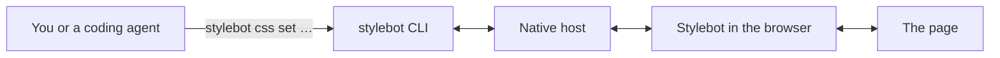

# Stylebot CLI

The `stylebot` command drives Stylebot in a browser that's already running. It can open a page, look at it, change its style and take a screenshot of the result. It's made for scripts and for coding agents like Claude Code, Codex and Cursor.



It runs on macOS, Linux and Windows with these browsers. Safari isn't supported yet.

| Browser  | macOS | Linux | Windows |
| -------- | :---: | :---: | :-----: |
| Chrome   |   ✓   |   ✓   |    ✓    |
| Firefox  |   ✓   |   ✓   |    ✓    |
| Edge     |   ✓   |   ✓   |    ✓    |
| Brave    |   ✓   |   ✓   |    ✓    |
| Chromium |   ✓   |   ✓   |    ✓    |
| Vivaldi  |   ✓   |   ✓   |    ✓    |
| Arc      |   ✓   |       |         |

## Setup

You need Node 20 or later and Stylebot 4 or later.

1. Install the CLI and register it with your browsers:

   ```bash
   npm install -g @stylebot/cli
   ```

   ```bash
   stylebot install
   ```

2. In Stylebot's options, under **Basics**, turn on **Allow command line access** and accept the browser's prompt.
3. Check that it works:

   ```bash
   stylebot tabs
   ```

`stylebot install` prints a checklist: the browsers it found, whether Stylebot is in one, and whether it's connected. Run it again whenever something's off, or after installing a new browser. A browser only counts once it has been opened at least once.

### Running this checkout's CLI

Use `yarn stylebot` inside the repo, and run `yarn stylebot install` once so the dev browsers from `yarn dev:chrome` find it too. To call it as `stylebot` from anywhere on macOS or Linux:

```bash
ln -s "$PWD/tools/cli/bin/stylebot.mjs" ~/bin/stylebot
```

### When it can't connect

The CLI works out what's wrong and prints one fix:

| What's wrong                                   | Fix                                   |
| ---------------------------------------------- | ------------------------------------- |
| No browser it can set up                       | Install Chrome, Firefox or Edge       |
| No browser profile has Stylebot                | Add Stylebot                          |
| No browser has ever started the CLI's host     | Turn on **Allow command line access** |
| A browser started it before, but it's gone now | Open the browser, with Stylebot on    |

If the setting was already on before you ran `install`, reload Stylebot or restart the browser.

## More

- [Commands](cli/commands.md): pages, inspecting, the pointer, several browsers
- [Styles, profiles and options](cli/styles.md): reading, editing and checking a site's CSS
- [Forced states](cli/forced-states.md): seeing hover and focus styles without a real pointer
- [CLI mode](cli/cli-mode.md): marking up the page and leaving notes for your agent
- [Coding agents](cli/coding-agents.md): installing the Stylebot skill in your agent
- [How it works](cli/how-it-works.md): the native host, versions, and running a second dev browser
