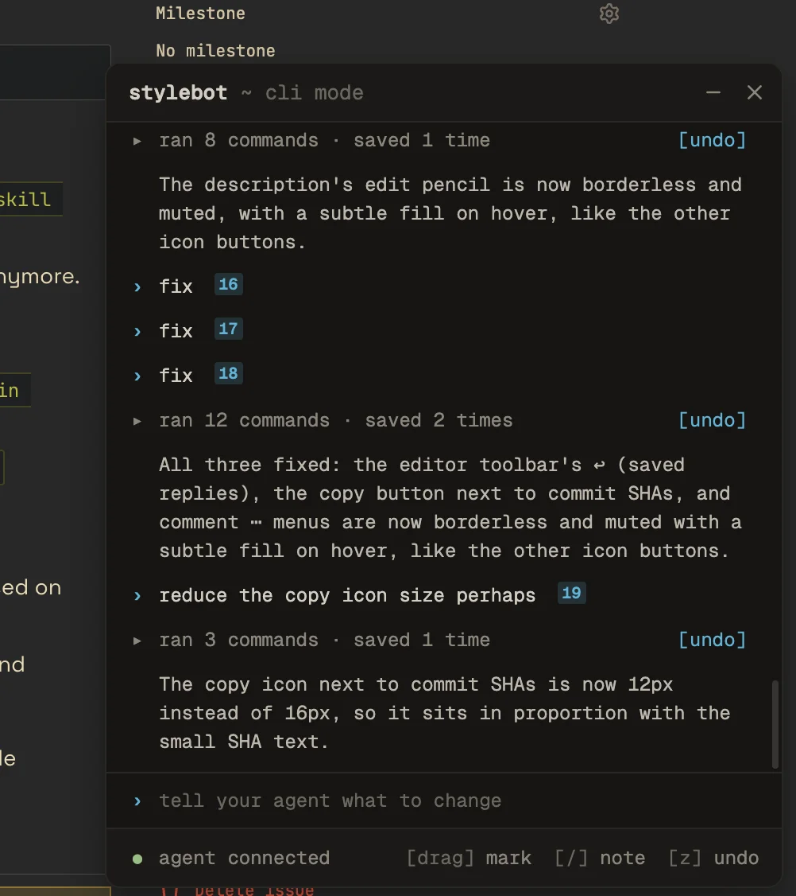
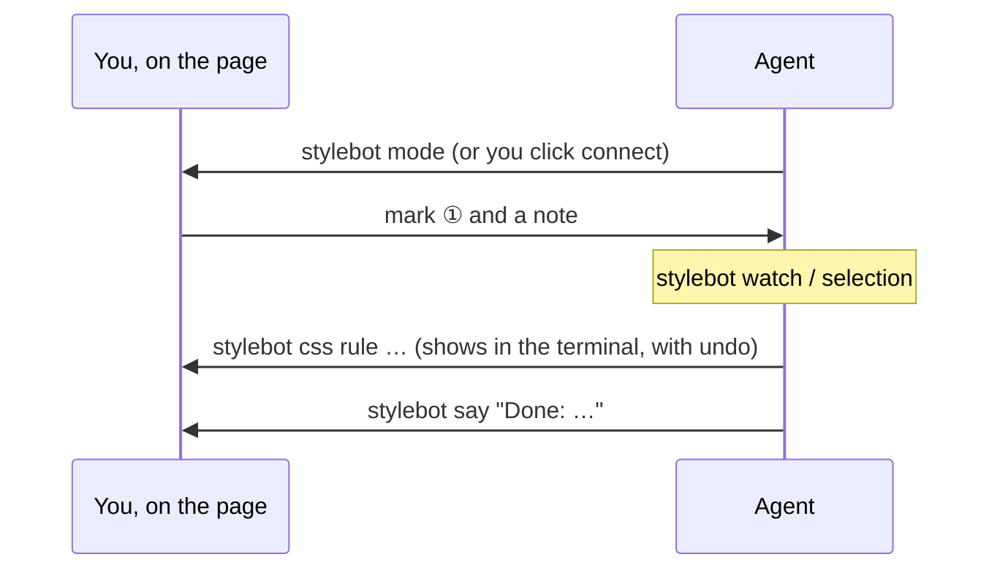

# CLI mode

CLI mode lets you work with your agent from the page itself. A small terminal on the tab shows each command the agent runs and each save, with an undo. You mark parts of the page and leave notes, and the agent makes the change and replies.

## Using it

1. **Connect.** Ask your agent to watch, then click **[connect]** on the tab you want to work on. Only one tab is connected at a time; others offer **[move here]**.
2. **Mark.** Drag over part of the page. Click a mark's number to remove it.
3. **Note.** Type in the terminal and press Enter (Shift+Enter for a new line). The agent gets your note with a screenshot of the marks.

| Key | Does               |
| --- | ------------------ |
| `.` | Open or minimize   |
| `/` | Write a note       |
| `Z` | Undo the last save |
| `X` | Clear the marks    |

The keys work anywhere on the page except in a text field.

## On the agent's side

- `mode <tab>` connects a tab, and `mode <tab> --off` disconnects it.
- `watch` prints a line for each event: the tab connecting, marks, notes, navigation, and edits made outside the CLI.
- `selection` lists the notes and marks since it last looked, with the elements inside each mark. `--wait` waits for the next one.
- `say` answers your note in the terminal.
