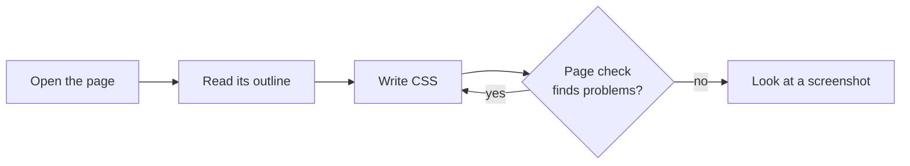

# Coding agents

The Stylebot skill teaches a coding agent to restyle pages with the CLI. It opens the page, reads its outline, writes CSS, fixes what the page check reports, and then checks a screenshot.



It works in any agent that can run shell commands and write files on the same machine as the browser, once the CLI is [set up](../cli.md#setup). Ask for a look ("give Hacker News a dark theme") and the agent picks the skill up, or invoke it by name. With no request, it suggests ideas for the page.

Its changes go into a new profile named after the agent and the look, like "Claude: Dark", so your own style stays one click away. If you name a profile, or are in [CLI mode](cli-mode.md), it edits that profile instead. It keeps its working files in `~/.stylebot/work/`.

## Install

| Agent             | Install from            | Tested                                               |
| ----------------- | ----------------------- | ---------------------------------------------------- |
| Claude Code       | This repo's marketplace | Measured by the [styling evals](../styling-evals.md) |
| Codex CLI         | This repo's marketplace | Installs and lists the skill (0.163.0)               |
| Copilot CLI       | This repo's marketplace | Installs and loads the skill (1.0.99-2)              |
| Copilot (VS Code) | Copy the skill folder   | From its docs only                                   |
| Cursor            | Copy the skill folder   | From its docs only                                   |
| Antigravity CLI   | Copy the skill folder   | From its docs only                                   |

Agents installed from the marketplace use the `stylebot` on your `PATH`, or the published one through `npx` if there isn't one. For the others, install the CLI first with `npm install -g @stylebot/cli`. Commands and folders below are as of October 2026.

### Claude Code

```bash
claude plugin marketplace add ankit/stylebot
```

```bash
claude plugin install stylebot
```

Then use `/stylebot <site> <what to change>`. It runs without permission prompts. To try this checkout's plugin, use `./` instead of `ankit/stylebot`, or run `claude --plugin-dir tools/agent-plugin`.

### Codex CLI

```bash
codex plugin marketplace add ankit/stylebot
```

```bash
codex plugin add stylebot@stylebot
```

In a new session, ask for a look or pick `stylebot` from `/skills`. To skip approving each command, choose "always allow" at the first prompt, or add this to `~/.codex/rules/default.rules`:

```python
prefix_rule(pattern = ["stylebot"], decision = "allow")
```

### Copilot CLI

```bash
copilot plugin marketplace add ankit/stylebot
```

```bash
copilot plugin install stylebot@stylebot
```

Check it loaded with `copilot skill list`. Copilot forgets approvals between sessions, so approve `stylebot` at the first prompt, or start with `copilot --allow-tool='shell(stylebot:*)'`.

### Copilot in VS Code, Cursor and Antigravity CLI

Copy the skill folder from this checkout into the agent's skills folder, then restart the agent:

```bash
cp -R tools/agent-plugin/skills/stylebot ~/.cursor/skills/
```

| Agent             | Skills folder                       | Allow `stylebot` without prompts                                                                 |
| ----------------- | ----------------------------------- | ------------------------------------------------------------------------------------------------ |
| Copilot (VS Code) | `~/.copilot/skills/`                | `"chat.tools.terminal.autoApprove": { "stylebot": true }` in user settings                       |
| Cursor            | `~/.cursor/skills/`                 | Add `stylebot` under Settings › Agents › Approvals & Execution › Allowlist                       |
| Antigravity CLI   | `~/.gemini/antigravity-cli/skills/` | `"permissions": { "allow": ["command(stylebot)"] }` in `~/.gemini/antigravity-cli/settings.json` |

Then ask for a look, or type `/stylebot`.
