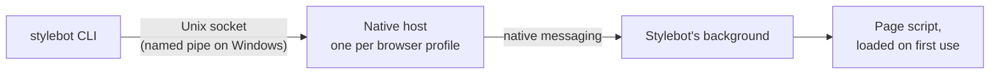

# How the CLI works



- **The host.** When Stylebot connects, the browser starts the CLI's native host and keeps it running while connected. Each browser profile gets its own host, listening on its own socket in `~/.stylebot/browsers/` that only you can read. The host just passes messages back and forth.
- **Finding browsers.** The CLI finds browsers by their sockets. With more than one, it asks each which browser it is and what page it shows. Sockets left behind by a host that crashed are cleaned up.
- **The page.** The code that reads a page only loads the first time the CLI asks about that page, and only in the top frame.
- **Permissions.** Stylebot connects only while the setting is on and the browser has granted `nativeMessaging`. Screenshots use `<all_urls>`, which Stylebot already has.
- **Turning it on.** Chrome only lets Stylebot reach the host after it restarts, so turning the setting on restarts Stylebot once. That disconnects Stylebot from open tabs, so it then reloads itself into them, as it does after an update.

## Versions

The extension updates from the browser's store and the CLI from npm, so they can be on different versions. Every request and response carries a protocol number:

- **Same protocol:** it works.
- **Different protocol:** the extension refuses, and the CLI says which side to update.
- **No protocol:** the extension is too old, so update Stylebot.

Bump the protocol in the CLI and the extension together when a command's arguments or result change in a way the other side would misread, such as a renamed or removed field. A new command or optional field doesn't need a bump.

The installed host remembers which CLI version installed it. A different CLI version reinstalls it quietly, and fixes its path to Node if Node moved, for example after an upgrade. If the browser then can't start the host, the CLI asks you to restart the browser.

## Where browsers find the host

`stylebot install` writes a manifest that points to the host and allows only Stylebot's store ids. On macOS and Linux it goes in each browser's `NativeMessagingHosts` folder; on Windows it's registered under `HKCU\Software\…\NativeMessagingHosts`.

| Browser  | macOS (`~/Library/Application Support/…`) | Linux                                   | Windows (`HKCU\Software\…`) |
| -------- | ----------------------------------------- | --------------------------------------- | --------------------------- |
| Chrome   | `Google/Chrome`                           | `~/.config/google-chrome`               | `Google\Chrome`             |
| Edge     | `Microsoft Edge`                          | `~/.config/microsoft-edge`              | `Microsoft\Edge`            |
| Brave    | `Google/Chrome` (shares Chrome's)         | `~/.config/BraveSoftware/Brave-Browser` | `Google\Chrome`             |
| Chromium | `Chromium`                                | `~/.config/chromium`                    | `Chromium`                  |
| Vivaldi  | `Vivaldi`                                 | `~/.config/vivaldi`                     | `Google\Chrome`             |
| Arc      | `Arc/User Data`                           |                                         |                             |

The dev profiles from `yarn dev:chrome` get their own registration on macOS and Linux.

## A second dev browser

A test or another worktree can run its own dev browser beside yours. To keep the CLI from seeing yours at all, give it its own profile and socket:

```bash
STYLEBOT_PROFILE_DIR=.chrome-dev-profile-test STYLEBOT_SOCKET=~/.stylebot/test.sock yarn start:chrome
```

Run `stylebot install` once the profile folder exists, then run the CLI with the same `STYLEBOT_SOCKET`. Use `yarn preview:chrome` instead for a release-like build with the store's extension id.

On Windows, `STYLEBOT_SOCKET` names a named pipe, and the first browser to connect to it keeps it until it quits.

## Not done yet

- Firefox support
- A visible sign that the CLI is connected, since any local process can use the socket
