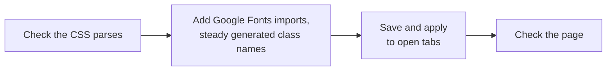

# Styles, profiles and options

## Reading and changing CSS

```bash
stylebot css get news.ycombinator.com --grep titleline
stylebot css rule 54432929 '.titleline a' --set color=#e8e6e3
stylebot css add 54432929 --file more.css
stylebot css set 54432929 < hn.css
```

| Command    | Does                                                                                                    |
| ---------- | ------------------------------------------------------------------------------------------------------- |
| `styles`   | Lists saved styles                                                                                      |
| `css get`  | Prints a style's CSS; `--grep` keeps only the rules that mention some text                              |
| `css rule` | Edits one rule: `--set prop=value`, `--unset prop`, or `--delete`; `--media` for a rule inside `@media` |
| `css add`  | Appends CSS to the end of the style                                                                     |
| `css set`  | Replaces the whole style; empty CSS deletes it                                                          |
| `css diff` | Shows what `css set` would change, without saving                                                       |

`css rule` and `css add` touch only what they're asked to, so the rest of the stylesheet keeps its formatting and comments. CSS comes from stdin or `--file`.

### What happens on save

`css set`, `rule` and `add` all save the same way:



The page check reports which elements each changed rule matched, and flags problems such as text that's hard to read:

```text
$ stylebot css set news.ycombinator.com --file hn.css
Saved news.ycombinator.com
Checked on tab 1234.
Elements each added or changed rule matched:
- .titleline a: 30 elements
Problems the page check found:
- Hard to read: .subtext (30 elements), text #828282 on #1d1f21, contrast 3.1:1
```

The check runs when the saved profile is the one in use and a tab shows the site; name a tab id to choose which tab it checks.

`css diff` prints only what differs:

```text
$ stylebot css diff news.ycombinator.com --file hn.css
  .subtext {
-   color: #828282;
+   color: #a8a8a8;
  }

Rules: 0 added, 1 changed, 0 removed. Nothing saved.
```

## Profiles

A site can have several named [profiles](../profiles.md), one in use at a time.

```bash
stylebot profile create Dark news.ycombinator.com --use
stylebot css set news.ycombinator.com --profile Dark < dark.css
```

- `profiles` lists them, starring the one in use.
- `profile create`, `use`, `rename` and `delete` manage them.
- The `css` commands take `--profile` to work on a profile other than the one in use.

## Style options

[Style options](../style-options.md) are settings a style declares in its CSS, like a light/dark switch.

```bash
stylebot options news.ycombinator.com
stylebot option set scheme dark news.ycombinator.com
```

- `options` lists each option with its type, value, allowed values and default.
- `option set` changes one and applies it to open tabs. It refuses values the option doesn't take.
